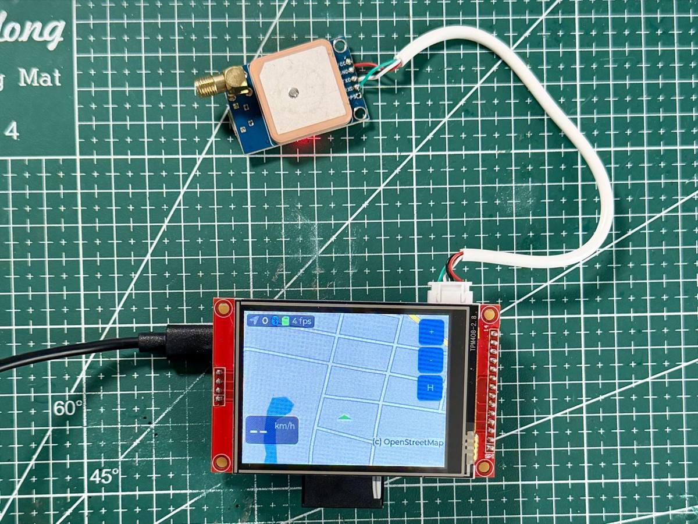

# NavESP: thiết bị dẫn đường xe máy tự làm

Màn hình 2,8 inch gắn trên xe máy, hiện bản đồ, tên đường tiếng Việt và chỉ dẫn rẽ. Tuyến đường tính trên iPhone rồi gửi xuống thiết bị qua Bluetooth. Bản đồ nằm sẵn trên thẻ SD nên xem bản đồ không cần mạng.

Trang hướng dẫn và nạp firmware trên trình duyệt: **https://esp32nav.thomas-vu.net**

## Thư mục

| Thư mục | Nội dung |
|---|---|
| `firmware/nav/` | Firmware ESP32-S3 (ESP-IDF 5.5, LVGL 9) |
| `ios/` | App iPhone NavESP (SwiftUI, XcodeGen) |
| `tools/map_render/` | Công cụ tạo bản đồ cho thẻ SD từ dữ liệu OpenStreetMap |
| `tools/osrm/` | Profile xe máy và hướng dẫn tự dựng máy chủ chỉ đường OSRM |
| `tools/ble_test/` | Gửi tuyến thử từ máy tính qua Bluetooth (cho người phát triển) |
| `docs/` | Hướng dẫn sử dụng, sơ đồ nối dây, giao thức Bluetooth |

## Bắt đầu

Xem **[docs/huong-dan.md](docs/huong-dan.md)**: linh kiện, nối dây, nạp firmware, chuẩn bị thẻ bản đồ, cài app, chọn máy chủ chỉ đường.

## Tính năng

- Bản đồ ngày/đêm tự render (không chữ), tên đường tiếng Việt luôn đứng thẳng khi bản đồ xoay theo hướng đi.
- Zoom tự đổi theo tốc độ; ô chỉ dẫn rẽ, quãng đường còn lại; tự dừng khi tới nơi.
- App: tìm điểm đến, tính đường (máy chủ demo hoặc máy chủ riêng), tự tính lại khi lệch tuyến, chế độ ngày/đêm theo giờ mặt trời.
- Log chuyến đi ra thẻ SD.

## Giấy phép

- Mã nguồn: MIT, xem [LICENSE](LICENSE).
- Dữ liệu bản đồ: © [OpenStreetMap contributors](https://www.openstreetmap.org/copyright), giấy phép ODbL. Bản đồ tạo ra từ dữ liệu này phải ghi nguồn OpenStreetMap (thiết bị luôn hiện dòng này trên màn hình).
- Font Be Vietnam Pro: SIL Open Font License, xem `tools/map_render/fonts/OFL.txt`. Font nhúng trong firmware (`font_vn_*.c`) được tạo từ font này.

Dự án cá nhân, chia sẻ để mọi người tự làm. Không có bảo hành; tự chịu trách nhiệm khi lắp lên xe và khi đi đường.
