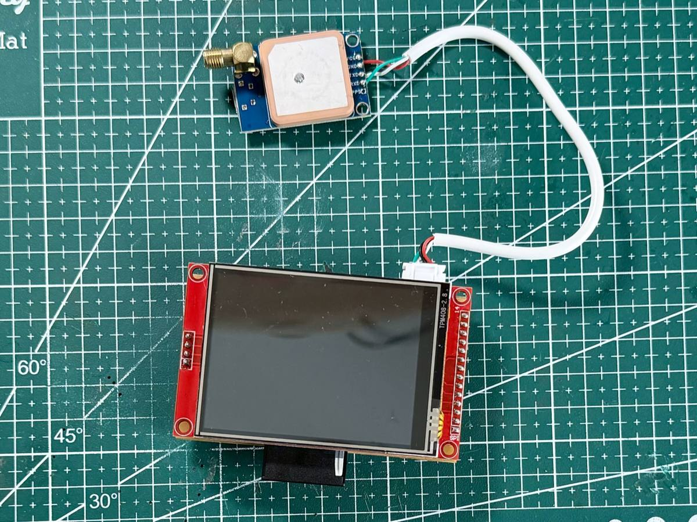
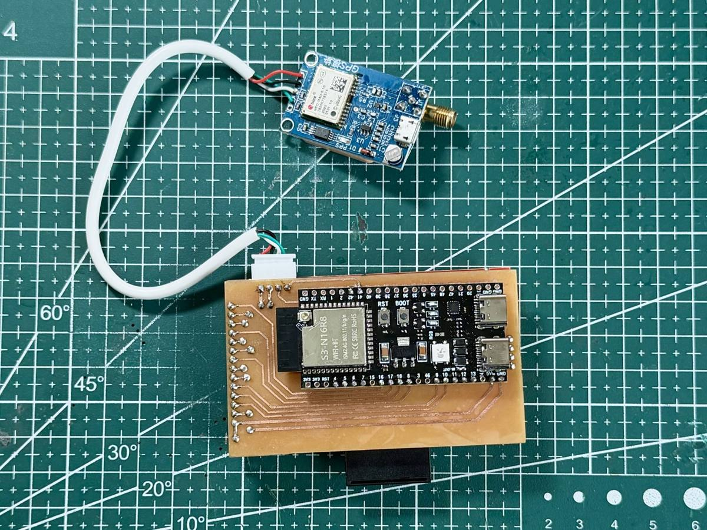

# Sơ đồ nối dây – ESP32-S3 navigation

| Mặt trước | Mặt sau |
|---|---|
|  |  |

Bảng chân lấy theo code hiện tại (`firmware/nav`). Chân GPIO ghi theo số GPIO của ESP32-S3, không phải số thứ tự chân trên board.

## 1. Màn hình ST7789 320x240 + cảm ứng XPT2046 (bus SPI2)

Màn hình và cảm ứng dùng chung SCK/MOSI/MISO, mỗi cái có CS riêng.

| Chân module | GPIO ESP32-S3 | Ghi chú |
|---|---|---|
| VCC | 3V3 | |
| GND | GND | |
| LCD SCK / SCL | 12 | dùng chung với T_CLK |
| LCD MOSI / SDA / SDI | 11 | dùng chung với T_DIN |
| LCD MISO / SDO | 13 | dùng chung với T_DO |
| LCD CS | 10 | |
| LCD DC / RS | 8 | |
| LCD RST | 9 | |
| LED / BL (đèn nền) | 18 | mức 1 = bật |
| T_CLK | 12 | |
| T_DIN | 11 | |
| T_DO | 13 | |
| T_CS | 17 | |
| T_IRQ | 16 | |

- Clock màn hình: **40 MHz**. Đã chạy ổn định 10/10 lần trên mạch hàn. Với dây cắm dài, 40 MHz từng làm thẻ SD lỗi.
- Thẻ SD hiện dùng khe trên màn hình, xem mục 2.

## 2. Thẻ SD: khe trên màn hình (bus SPI3, tách riêng khỏi bus màn hình)

Từ 2026-11-04 dùng khe SD trên màn hình (qua chân SD_*), bỏ module rời. Đã mount được 10/10 lần reset. Phần ghi chú về module rời bên dưới chỉ còn để tham khảo.

| Chân module SD | GPIO ESP32-S3 | Ghi chú |
|---|---|---|
| CS | 7 | |
| MISO / DO | 5 | |
| MOSI / DI | 6 | |
| SCK / CLK | 4 | |
| VCC | xem bên dưới | |
| GND | GND | đi dây GND riêng, ngắn, về sát ESP32 |

**Cấp nguồn – kiểm tra loại module trước khi hàn:**

- **Module có IC ổn áp (thường là AMS1117) và IC chuyển mức 74LVC125**, loại phổ biến, có ghi "5V" hoặc có IC 3 chân: phải cấp **5V** vào VCC. Nếu cấp 3V3 vào loại này thì sau ổn áp chỉ còn khoảng 2.x V, thẻ chạy chập chờn: lúc mount được, lúc không, đọc dữ liệu bị timeout, đúng như lỗi đang gặp.
- **Module không có ổn áp** (chỉ có khe thẻ và vài điện trở): cấp **3V3**. Tuyệt đối không cấp 5V.

**Để chạy ổn định:**

1. Dây SD càng ngắn càng tốt, dưới 10 cm. Không cho dây SD chạy song song sát dây SCK/MOSI của màn hình.
2. Hàn tụ **10–100 µF** (tụ hoá hoặc tantalum) cùng một tụ **100 nF** giữa VCC và GND, đặt **sát module SD**. Thẻ SD hút dòng xung khá lớn khi đọc/ghi.
3. Điện trở kéo lên **10 kΩ lên 3V3** cho **MISO (GPIO5), MOSI (GPIO6) và CS (GPIO7)**, theo khuyến nghị của Espressif cho SD qua SPI. Nếu module đã có sẵn điện trở kéo lên thì bỏ qua bước này.
4. Thẻ format **FAT32** (MBR). Bản đồ: mỗi tỉnh một thư mục `nav_map_<tỉnh>` ở gốc thẻ, xem `tools/map_render/README.md`.
5. Clock SD: **20 MHz**. Đã chạy ổn định 10/10 lần trên mạch hàn với module SD rời. Nếu lại bị lỗi, hạ xuống 10 MHz.

## 3. GPS (UART1)

Firmware tự nhận module lúc khởi động: NEO-M8U (UBX, 115200) hoặc NEO-6M (NMEA, 38400 hay 9600). Nối dây như nhau.

| Chân module GPS | GPIO ESP32-S3 | Ghi chú |
|---|---|---|
| TXD | 42 (RX của ESP) | |
| RXD | 41 (TX của ESP) | |
| PPS | không nối | firmware không dùng |
| VCC | 5V | tách xa màn hình và ESP32, nối bằng dây dài |
| GND | GND | |

Ăng-ten GPS cần nhìn thấy bầu trời; khi để trong nhà thì fix chập chờn, chỉ thấy 0–6 vệ tinh.

## 4. Nguồn và GND chung

- Cấp nguồn 5 V qua cổng USB-C của DevKit (sạc dự phòng, hoặc bộ hạ áp từ ắc quy xe). Một số DevKit cần nối jumper để chân 5Vin có 5 V.
- Tất cả GND (màn hình, SD, GPS) nối chung về GND của ESP32-S3, nên đi hình sao (mỗi module một dây về một điểm) thay vì nối nối tiếp từ module này sang module khác.
- Chân 3V3 của board ESP32-S3 thường cấp được khoảng 500 mA. Đèn nền, màn hình, GPS và thẻ SD cộng lại có thể gần tới mức đó. Nếu dùng module SD loại 5V thì lấy 5V từ chân 5V/VBUS (nguồn USB).
- Thêm một tụ **100 µF** giữa 3V3 và GND trên test board, gần ESP32.

## 5. Kiểm tra sau khi hàn

1. Nạp firmware (`docs/huong-dan.md`), cắm thẻ đã chép bản đồ.
2. Mở cổng serial (115200): log khởi động phải có `Thu muc ban do: nav_map_...` và không có `Mount SD that bai`.
3. Reset khoảng 10 lần, lần nào thẻ cũng phải mount được. Sau đó thử kéo và zoom bản đồ, bấm các nút trên màn hình.
