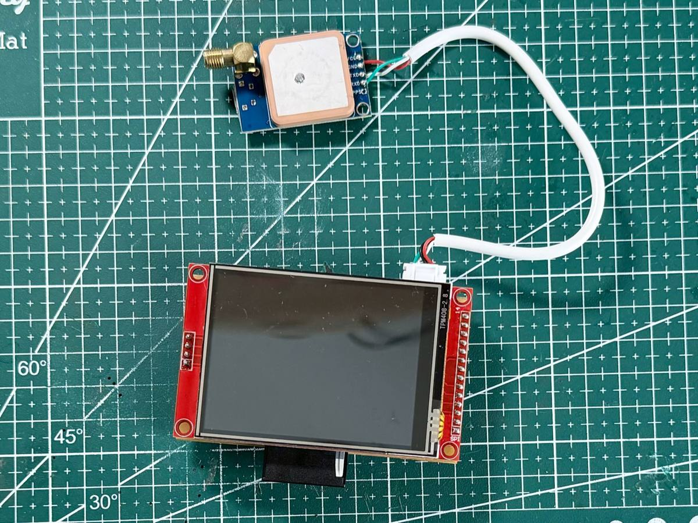
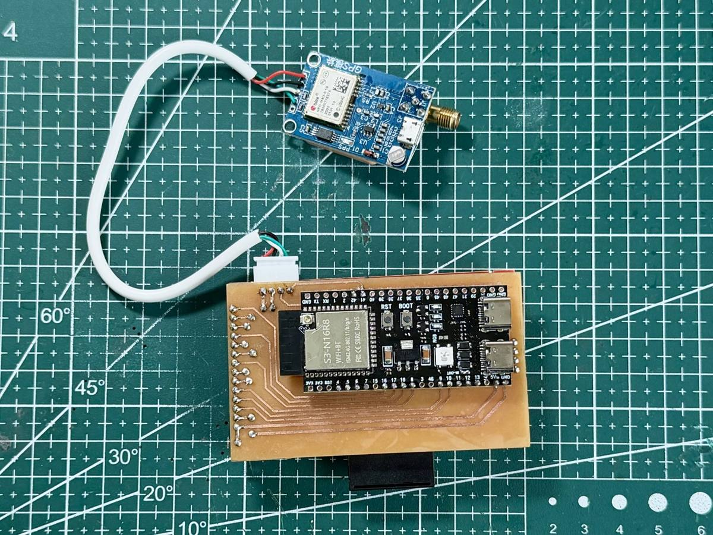

# Hướng dẫn sử dụng

Thứ tự: (1) làm phần cứng → (2) nạp firmware → (3) chép bản đồ vào thẻ SD → (4) cài app iPhone → (5) chọn máy chủ chỉ đường.

## 1. Phần cứng

| Linh kiện | Ghi chú |
|---|---|
| ESP32-S3 DevKit **N16R8** | 16 MB flash, 8 MB PSRAM (bắt buộc có PSRAM) |
| Màn hình 2,8" ST7789 320x240, cảm ứng XPT2046, có khe thẻ SD | module SPI phổ biến |
| GPS u-blox NEO-M8N hoặc NEO-M8U (hoặc NEO-6M) | firmware tự nhận loại khi khởi động |
| Thẻ microSD, FAT32 | một tỉnh khoảng 0,5 GB |
| Đầu XH 4 chân cho GPS, dây, ốc M3 | |
| Nguồn 5 V qua USB-C | sạc dự phòng hoặc bộ hạ áp từ ắc quy xe |

| Mặt trước | Mặt sau (mạch một lớp, ủi toner) |
|---|---|
|  |  |

Nối chân, cấp nguồn cho thẻ SD và các lưu ý để chạy ổn định: **[WIRING.md](WIRING.md)**.

## 2. Nạp firmware

**Cách dễ nhất:** mở https://esp32nav.thomas-vu.net/nap-firmware.html bằng Chrome hoặc Edge trên máy tính, cắm DevKit bằng cáp USB, bấm "Nạp firmware NavESP". Không cần cài công cụ; nạp lại không xoá cài đặt đã lưu.

**Tự build** (cần [ESP-IDF 5.5](https://docs.espressif.com/projects/esp-idf/en/stable/esp32s3/get-started/)):

```
cd firmware/nav
idf.py build
idf.py -p <cổng, ví dụ /dev/cu.usbmodem... hoặc COM5> flash monitor
```

Lần build đầu tự tải các thư viện (LVGL, esp_lvgl_port, LZ4) theo `main/idf_component.yml`.

## 3. Chép bản đồ vào thẻ SD

Thiết bị đọc mọi thư mục `nav_map_<tỉnh>` ở **gốc thẻ** (ví dụ `nav_map_daklak`). Nhiều tỉnh thì nhiều thư mục.

- **Có sẵn:** trang https://esp32nav.thomas-vu.net/ban-do.html, bấm "Chép vào thẻ" (Chrome/Edge trên máy tính), chọn thư mục gốc của thẻ. Một tỉnh khoảng 450 MB, 6.700 file, chép mất khoảng 20–30 phút tuỳ thẻ.
- **Tự tạo cho tỉnh bất kỳ:** xem [tools/map_render/README.md](../tools/map_render/README.md).

Chưa có bản đồ cho vùng đang đứng thì màn hình chỉ có màu nền, vẫn dẫn đường được.

## 4. App iPhone

Hiện app chưa có trên App Store: tự build bằng Xcode trên máy Mac, xem [ios/README.md](../ios/README.md). Với Apple ID miễn phí, app phải cài lại mỗi 7 ngày.

Dùng app:

1. Bật Bluetooth, mở app: app tự tìm và kết nối thiết bị "NavESP" (Cài đặt → Kết nối để quét, ngắt, quên thiết bị).
2. Tìm điểm đến (hoặc giữ lâu trên bản đồ), xem tuyến, bấm **Bắt đầu**: tuyến được gửi xuống thiết bị.
3. Đi lệch tuyến: app tự tính lại và gửi tuyến mới. Tới nơi: thiết bị báo "Đã đến nơi" rồi thôi dẫn đường.
4. Cài đặt → Chế độ hiển thị: Tự động (theo giờ mặt trời mọc/lặn) / Ngày / Đêm.
5. Thử không cần ra đường: bấm **SIM** để thiết bị chạy giả lập dọc tuyến.

Nếu vuốt tắt app, iOS không tự mở lại app ở nền; thiết bị vẫn dẫn theo tuyến đã có nhưng không tính lại được khi lệch tuyến.

## 5. Máy chủ chỉ đường

App gửi điểm đi/đến lên máy chủ OSRM để tính tuyến.

- **Mặc định: máy chủ demo công cộng** `router.project-osrm.org`. Không cần cài gì, nhưng tính cho **ô tô** (có thể chỉ vào cao tốc, ít đi hẻm) và chỉ dùng thử.
- **Máy chủ riêng cho xe máy:** tự dựng theo [tools/osrm/README.md](../tools/osrm/README.md), hoặc được người có máy chủ mời. Trong app: Cài đặt → Máy chủ chỉ đường → bật "Dùng máy chủ riêng", nhập địa chỉ và khoá (header `X-Route-Key`), hoặc **Quét mã QR** dạng `navesp://server?url=<địa chỉ>&key=<khoá>`.

Máy chủ riêng lỗi hoặc chậm quá 4 giây thì app tạm dùng máy chủ demo.

## Cho người phát triển

- Giao thức Bluetooth giữa app và thiết bị: [ble_protocol.md](ble_protocol.md).
- Thử giao thức từ máy tính: `tools/ble_test/send_route.py` (Python + bleak).
- Log trên thẻ: `/logs/NAVxxxxx.CSV` (mỗi lần khởi động một file). Log của app: app Tệp → NavESP → `NavESP-log.txt`.
